# VisualPortfolio.Net

1. 策略組合報表(Visual Portfolio)網路版，有下面特色：
   1. https://visualportfolio.sibuzu.com/ 不用安裝，直接網頁使用。
   2. 編輯後，可以直接分享連結，如 https://visualportfolio.sibuzu.com/projects/VP-ZDEMOZ
   3. 桌面版(VisualPortfolio.exe)可以直接下載/上傳 網路版(VisualPortfolio.Net) 的資料。
   4. VisualPortfolio.Net 的網路資料，72小時若都沒有access，將會自動刪除。

2. 使用STEPS:
   1. 第一次連結 https://visualportfolio.sibuzu.com/  應該會跳到 login 畫面。

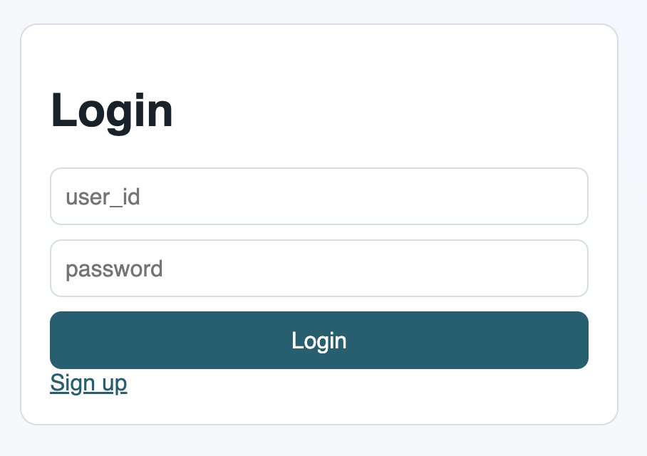

2. 點 Sign up，建立一個帳號後，進入主頁面。
3. 主頁面 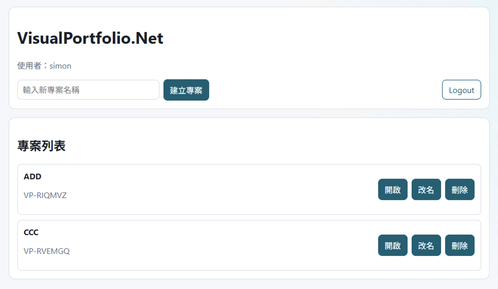

4. 建立新專案或是開始舊專案
5. 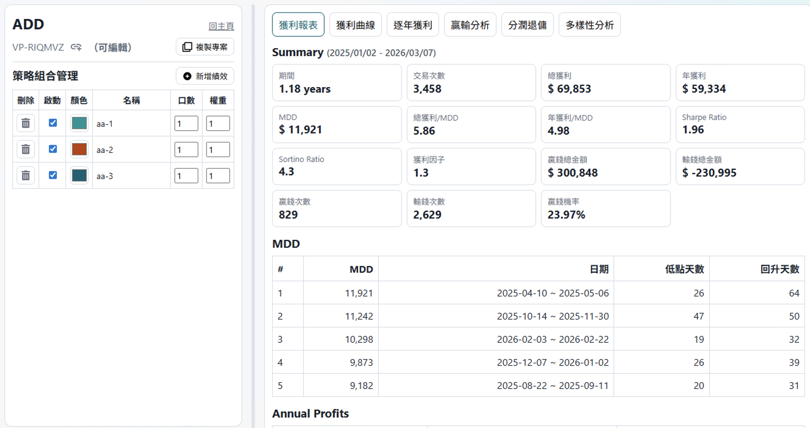

6. 若是自已的專案，則是(可編輯)，若不是就是(可檢視)，copy 網頁連結或是(可編輯)前的icon就會 copy link，把 link 分享給其他人，別人就可以看到這個專案的策略績效組合。
7. 在(可編輯)模式下，編輯的策略、口數、權重會自動儲存。
8. 在(可檢視)模式下，不能新增或刪除策略，但可以修改口數、權重，但修改的口數、權重只次當下有效，不會儲存。
9. 若是要修改並儲存，可以「複製專案」，則會產生一個新的專案，owner user-id 為自已，為(可編輯)模式。
10. 獲利曲線 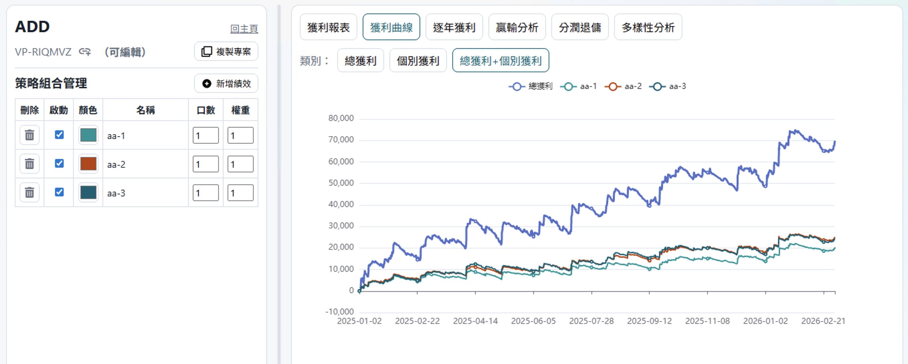
11. 逐年獲利 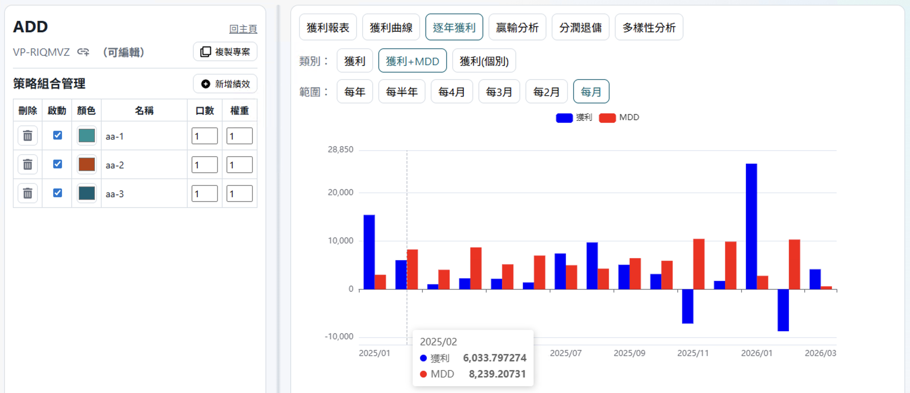
12. 贏輸分析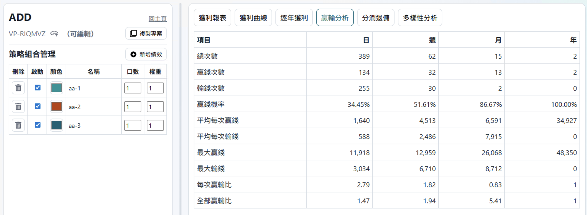
13. 分潤退傭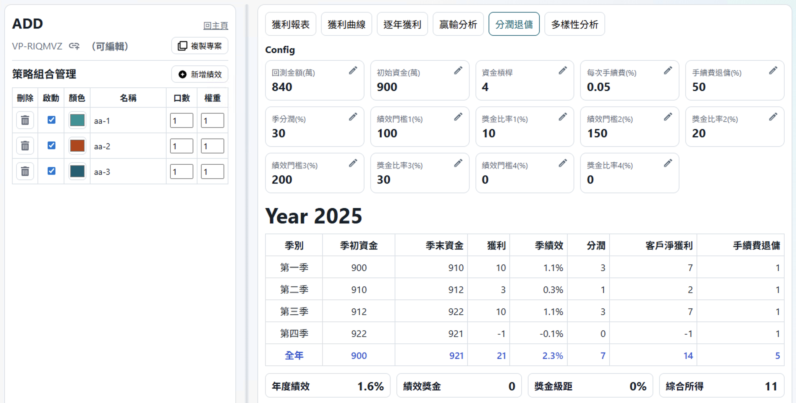
14. 多樣性分析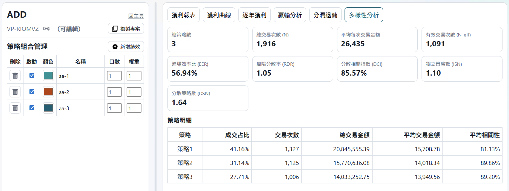
15. Desktop VisualPorfolio 上傳/下載，更新 VisualPorfolio.exe 至 v26.03.17.23964 之後版本，會多兩個 上傳/下載 的 BUTTONS。 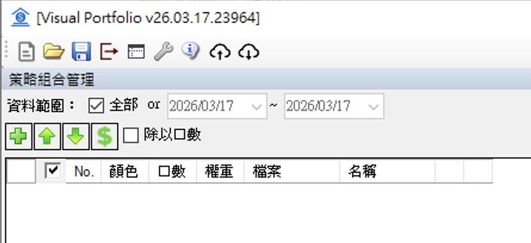
    
16. 上傳時，需要登入帳號，若是沒有登入，會出現LOGIN Dialog 請你登入，請記得要跟網頁登入的帳號一樣，不然網頁專案列表會看不到。 上傳後，專案user-id 為自已，若是專案已存在，若是自已的專案就會蓋掉，若是別人的將會被 reject。 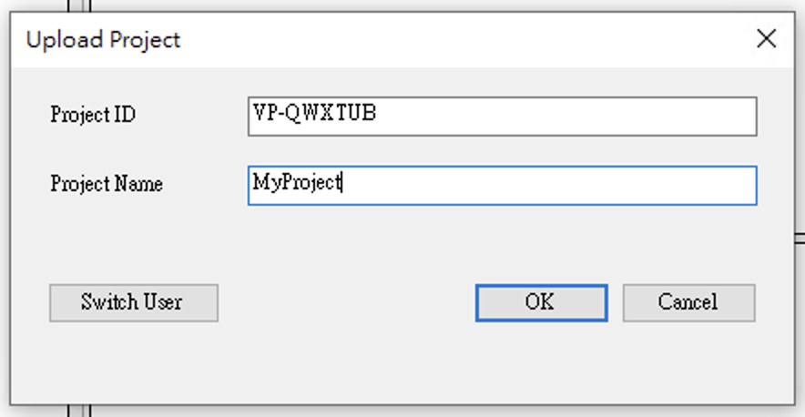

17. 下載時，可以不用登入帳號，只接打專案id(如 VP-RIQMVZ)，或是專案 url link(如 https://visualportfolio.sibuzu.com/projects/VP-RIQMVZ)。  也可以點「取得專案列表」，但需要LOGIN(若沒login會出現login的視窗)，就會列出你自已的 projects，然後點選後就可以下載。 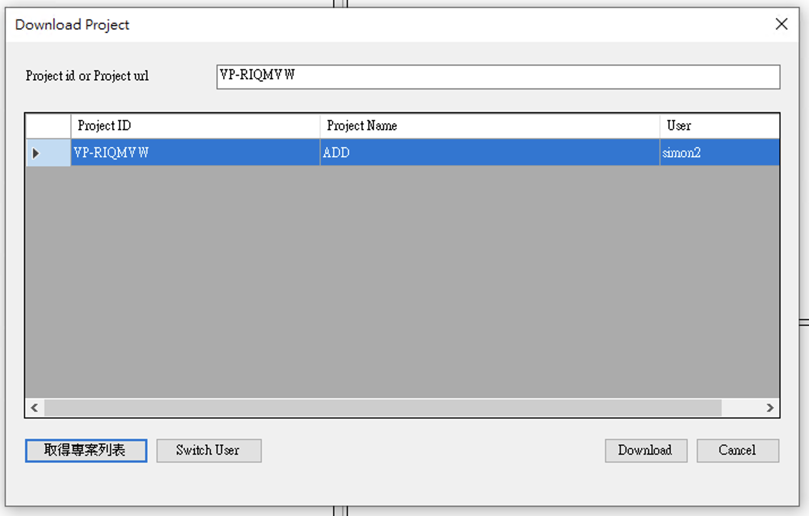