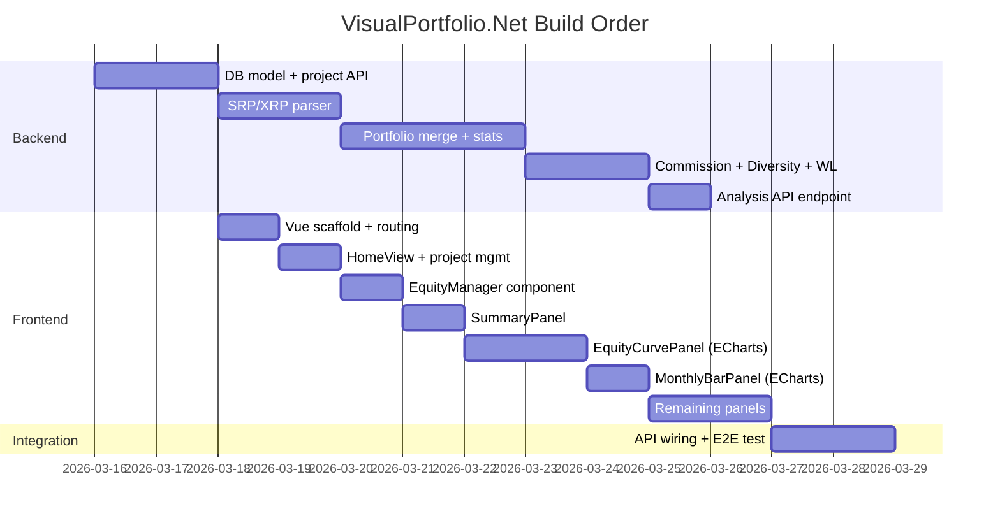

# VisualPortfolio.Net — Implementation Plan

## Overview

Port the existing C# WinForm **VisualPortfolio** application to a full-stack web application.

| Layer | Technology |
|---|---|
| Frontend | Vue 3 + Vite + ECharts |
| Backend | Python 3.11+ + FastAPI |
| Database | SQLite (`data/db/`) |
| File Storage | Local filesystem (`data/projects/{project-id}/`) |

The original WinForm app allows traders to load multiple strategy backtest result files (`.srp` / `.xrp` XML format), combine them into a portfolio, and view rich analytics (summary stats, equity curve, monthly bar charts, position analysis, win/loss, commission, diversity metrics). The web version replicates all those panels as interactive pages/tabs.

---

## Directory Layout (Target)

```
VisualPorfolio.Net/
├── backend/
│   ├── main.py                  # FastAPI entry point
│   ├── routers/
│   │   ├── projects.py          # project CRUD
│   │   ├── files.py             # file upload / list
│   │   └── analysis.py          # compute & return all analytics
│   ├── services/
│   │   ├── parser.py            # SRP / XRP XML parser (port of ClsTradeList.cs)
│   │   ├── portfolio.py         # portfolio merge & filter (port of FormMain UpdatePortfolio)
│   │   ├── summary_report.py    # stats engine (port of SummaryReport.cs)
│   │   ├── commission.py        # commission calc (port of ClsCommission.cs)
│   │   ├── diversity.py         # diversity metrics (port of FormDiversity.cs)
│   │   └── win_loss.py          # win/loss calc (port of ClsWinLoss.cs)
│   ├── db/
│   │   └── database.py          # SQLite setup via SQLModel/SQLAlchemy
│   ├── models/
│   │   └── project.py           # Project SQLModel / Pydantic schemas
│   └── requirements.txt
├── frontend/
│   ├── index.html
│   ├── vite.config.js
│   ├── src/
│   │   ├── main.js
│   │   ├── App.vue
│   │   ├── router/index.js
│   │   ├── stores/
│   │   │   ├── project.js       # Pinia store – project list, active project
│   │   │   └── portfolio.js     # Pinia store – analysis results
│   │   ├── api/
│   │   │   └── index.js         # Axios wrapper for FastAPI calls
│   │   ├── views/
│   │   │   ├── HomeView.vue     # Project list / landing page
│   │   │   ├── ProjectView.vue  # Main workspace (tabbed panels)
│   │   │   └── NotFound.vue
│   │   └── components/
│   │       ├── EquityManager.vue     # Strategy list (add/remove/reorder/color/weight)
│   │       ├── SummaryPanel.vue      # Key metrics table
│   │       ├── EquityCurvePanel.vue  # ECharts line chart (profit / drawdown)
│   │       ├── MonthlyBarPanel.vue   # ECharts bar chart (by year/month)
│   │       ├── PositionPanel.vue     # Position analysis table
│   │       ├── WinLossPanel.vue      # Win/loss breakdown table
│   │       ├── CommissionPanel.vue   # Commission settings & result table
│   │       └── DiversityPanel.vue    # Diversity metrics table
└── data/
    ├── db/
    │   └── projects.db          # SQLite file (auto-created)
    └── projects/
        └── {project-id}/        # uploaded .srp / .xrp / .pfo files live here
```

---

## Phase 1 — Backend

### 1.1 Database Model (`backend/db/database.py`, `backend/models/project.py`)

SQLite table **projects**:

| Column | Type | Notes |
|---|---|---|
| project_id | TEXT PK | `VP[A-Z]{2}-[A-Z]{4}` format |
| user_id | TEXT | Guest UUID (from frontend) |
| project_name | TEXT | user-provided name |
| shared | BOOLEAN | default `false` |
| create_time | DATETIME | UTC |
| access_time | DATETIME | updated on every access |

Auto-cleanup job: on every API startup and hourly via `asyncio`, delete projects where `access_time < NOW - 72h` and purge their directories.

### 1.2 File Parser (`backend/services/parser.py`)

Port `ClsTradeList.LoadFile()` / `LoadSrpNode()` / `LoadXrpNode()` to Python:

- Detect file type by root XML element (`策略回測` → SRP, `CryptoReport` → XRP).
- Parse trade records into a list of `TradeItem` dicts: `{idx, trade_date1, trade_date2, profit, net_profit, trade_amount, bs, contract, price1, price2, point_value, strategy_index}`.
- Calculate per-file stats: `avg`, `stdev`, `period`, `net_profit`, `mdd`.
- Apply slippage from XML `<滑價>`.

### 1.3 Portfolio Merge (`backend/services/portfolio.py`)

Port `UpdatePortfolio()`:

- Merge trade lists from all active equities, tagging each item with `strategy_index`, `contract`, `weight`.
- Sort by `trade_date2` then `idx`.
- Filter by date range (start/end).
- Compute cumulative index `aux_idx`.

### 1.4 Statistics Engine (`backend/services/summary_report.py`)

Port `TSummaryReport.CreateSimpleReport()`:

- **Summary Part**: net profit, MDD (top-N), profit factor, win prob, avg win/loss, Sharpe ratio, Sortino ratio, SQN.
- **Annual/Monthly/Weekly Part**: bucket profits and MDD by year, month, quarter, week.
- **MDD tracking**: store start/end indices for overlaying on equity curve.

### 1.5 Other Service Ports

- `commission.py` — port `ClsCommission.cs`
- `diversity.py` — port `FormDiversity.cs` (VOR, EER, RDR, DCI, ENB, etc.)
- `win_loss.py` — port `ClsWinLoss.cs`

### 1.6 API Endpoints (`backend/routers/`)

#### Projects (`/projects`)

| Method | Path | Description |
|---|---|---|
| GET | `/projects?guest_id=...` | List projects for this user |
| POST | `/projects` | Create project (body: `{guest_id, project_name}`) → returns `{project_id}` |
| GET | `/projects/{project_id}` | Get project metadata (validates access) |
| PATCH | `/projects/{project_id}` | Update `shared`, `project_name` |
| DELETE | `/projects/{project_id}` | Delete project + files |

Access rules:
- `user_id == guest_id` → full edit access (update `access_time`)
- `shared=true`, `user_id != guest_id` → read-only (update `access_time`)
- `shared=false`, `user_id != guest_id` → 403

#### Files (`/projects/{project_id}/files`)

| Method | Path | Description |
|---|---|---|
| GET | `/projects/{id}/files` | List uploaded files |
| POST | `/projects/{id}/files` | Upload `.srp` / `.xrp` (multipart) |
| DELETE | `/projects/{id}/files/{filename}` | Remove a file |

Files saved to `data/projects/{project_id}/`.

#### Analysis (`/projects/{project_id}/analysis`)

| Method | Path | Description |
|---|---|---|
| POST | `/projects/{id}/analysis` | Run full analysis |

Request body:
```json
{
  "equities": [
    { "filename": "aa-1.srp", "active": true, "contract": 1, "weight": 1.0, "color": "#0000FF", "name": "Strategy A" }
  ],
  "date_range": { "start": "2020-01-01", "end": "2025-12-31", "all": true },
  "options": { "capital": 100, "risk_free_rate": 3.0, "mdd_count": 5, "div_by_count": false }
}
```

Response body (all panels in one call):
```json
{
  "summary": { "period": "...", "net_profit": 0, "mdd": 0, ... },
  "equity_curve": [ { "date": "2020-01-05", "profit": 1234, "drawdown": 0 } ],
  "monthly": [ { "period": "2020/01", "profit": 0, "mdd": 0 } ],
  "position_analysis": [ ... ],
  "win_loss": { ... },
  "commission": { ... },
  "diversity": { ... },
  "mdd_markers": [ { "start_idx": 0, "end_idx": 10, "value": -5000 } ]
}
```

#### PFO Save/Load (`/projects/{project_id}/pfo`)

| Method | Path | Description |
|---|---|---|
| GET | `/projects/{id}/pfo` | Download `.pfo` XML |
| PUT | `/projects/{id}/pfo` | Save equity list as `.pfo` XML |

`.pfo` format mirrors the existing WinForm XML structure (for interoperability).

---

## Phase 2 — Frontend

### 2.1 Guest UUID & Project Management

On first load, `App.vue` checks `localStorage` for `guest_uuid`. If absent, generates a UUID v4 and stores it. All API calls include it as a query/header param.

`HomeView.vue` fetches `GET /projects?guest_id=<uuid>` and lists the user's projects. A "New Project" button prompts for a name and calls `POST /projects`.

Projects can be shared (toggle switch → `PATCH /projects/{id}` with `shared=true`). A shareable URL containing `project_id` is shown.

### 2.2 Project Workspace (`ProjectView.vue`)

Layout: left sidebar **EquityManager** + tabbed right panel with 7 analysis tabs.

**EquityManager** (mirrors `FormEquityManage`):
- List of strategies with columns: Active (checkbox), #, Color (picker), Name, File, Contract, Weight, Edit (file picker), Delete.
- "Add File" button → opens file picker or drag-drop zone → uploads to `/projects/{id}/files`.
- "Move Up / Move Down" reorder buttons.
- "Div by Count" checkbox.
- Date-range pickers (Start / End / All checkbox).
- Any change triggers re-analysis call (`POST /projects/{id}/analysis`).

**Tabs:**
1. **Summary** (`SummaryPanel.vue`) — two-column key metrics table.
2. **Equity Curve** (`EquityCurvePanel.vue`) — ECharts line chart:
   - Y-axis: Cumulative Profit ($) or Drawdown ($).
   - X-axis: Trade Date.
   - Dropdown: Total / Separate / Total+Sep / Drawdown.
   - Year filter dropdown.
   - Overlay MDD segments as horizontal red bars.
   - Tooltip with date + value.
3. **Monthly Bar** (`MonthlyBarPanel.vue`) — ECharts bar chart:
   - Interval selector (Yearly / Half-year / Quarterly / Monthly).
   - Kind: Profit / Drawdown / Both / Sep Profit / Sep Drawdown.
   - Rolling average spinner.
   - Year drill-down.
4. **Position Analysis** (`PositionPanel.vue`) — table of open/closed positions.
5. **Win/Loss** (`WinLossPanel.vue`) — win/loss distribution tables.
6. **Commission** (`CommissionPanel.vue`) — commission summary table.
7. **Diversity** (`DiversityPanel.vue`) — diversity metrics table.

### 2.3 State Management (Pinia)

- `useProjectStore` — project list, active project id/name, file list, equity config.
- `usePortfolioStore` — analysis results (all panel data), loading state, error.

### 2.4 API Client (`src/api/index.js`)

Axios instance with base URL pointing to FastAPI. All requests tag `guest_id` automatically.

---

## Phase 3 — Cross-Cutting Concerns

### 3.1 CORS

FastAPI will allow `http://localhost:5173` (Vite dev) and production origin.

### 3.2 Auto-Deletion

Background task: on every project access, update `access_time`. A startup + periodic async task deletes projects with `access_time < now-72h` and their directories.

### 3.3 File Access in `.pfo`

`.pfo` must store filenames **relative** to the project directory (not absolute) so they are portable. On load, resolve relative to `data/projects/{project_id}/`.

---

## Verification Plan

### Backend — Unit Tests

Run with:
```powershell
cd d:\git\VisualPorfolio.Net\backend
pip install pytest httpx
pytest tests/ -v
```

Tests to write in `backend/tests/`:

| Test File | What it covers |
|---|---|
| `test_parser.py` | Parse `ref_result/project/aa-1.srp` → assert trade count, net_profit, MDD match known values; parse `Report.xrp` similarly |
| `test_portfolio.py` | Merge 3 SRP files with weights, assert sorted order and filtered date range |
| `test_summary.py` | Run stats engine on known trade list, assert Sharpe/Sortino/MDD values |
| `test_projects_api.py` | Create project, list, access control (403 for strangers, 200 for owner), delete |
| `test_analysis_api.py` | Upload SRP, call `/analysis`, assert response has all expected keys |

### Frontend — Manual Verification (Browser)

Start dev servers:
```powershell
# Terminal 1 — Backend
cd d:\git\VisualPorfolio.Net\backend
uvicorn main:app --reload --port 8000

# Terminal 2 — Frontend
cd d:\git\VisualPorfolio.Net\frontend
npm run dev
```

Open `http://localhost:5173` and verify:

1. **Guest UUID** — Open DevTools → Application → LocalStorage → confirm `guest_uuid` is set.
2. **Create Project** — Click "New Project", enter name, confirm project appears in list.
3. **Upload Files** — Open project, upload `ref_result/project/aa-1.srp`, `aa-2.srp`, `aa-3.srp`. Confirm they appear in the equity list.
4. **Analysis** — Confirm all 7 tabs populate with data (no empty/error states).
5. **Equity Curve** — Switch dropdown between Total / Drawdown; verify chart updates.
6. **Monthly Bar** — Toggle interval and year filter; verify bars update.
7. **Access Control** — Copy project URL, open in Incognito. If `shared=false` → should be denied. Toggle shared → Incognito user can view but not edit.
8. **PFO Round-trip** — Save `.pfo`, download it, re-upload by opening the `.pfo` in a new project, verify same strategies load.
9. **72h Expiry** — (requires time-travel test or manual DB update) Set `access_time` to >72h ago, restart backend, confirm project is purged.

---

## Implementation Order


